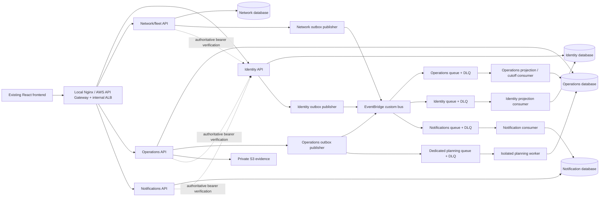

# Implemented backend architecture

## Boundaries and migration decision

Four independently deployable APIs are implemented: identity-access, network-fleet,
operations, notifications. They use separate database URLs, migration histories and
principals. Outbox publishers, consumer processes and a planning worker run independently.
There is no custom FastAPI gateway, Redis requirement, IaC or CI/CD implementation.

The proposed eight-context service map was reconciled with the code rather than implemented
as eight copies of a shared monolith. `OrderOut` traversed plans, trips, stops, deferrals,
proofs and receipts, while loading, publication and delivery changed these records in one
transaction. Orders/dispatch/loading/delivery therefore remain **co-deployed and co-owned by
operations** in this migration. They are not falsely described as independently isolated
services. Further extraction needs event-fed per-order read models, closure/publication
sagas and a frontend consistency budget. This decision preserves working behavior while
extracting reference ownership, authentication and notification delivery now.

## Internal structure

Transport routers call application use cases. Pure planner dataclasses, constraints,
strategies and workflow rules live in `operations/src/app/domain`; ORM models and planner
DB mapping live under `infrastructure/db`. SQLAlchemy sessions are units of work;
`OperationsUnitOfWork` and `JobRepository` explicitly bind job/plan/outbox updates.
Storage and allocation use typed ports; the deterministic allocator can be replaced by a
strategy without changing the independent feasibility validator. There is no solver dependency
or claim of optimal allocation. Its final feasibility pass removes individually infeasible orders, reschedules remaining
routes and records deferral explanations. Reducing avoidable deferrals remains an optimization objective.

Operational state changes and outbox rows commit together. Consumers commit inbox claims
and effects together. Projection revisions prevent an older reference or trip event from
reverting a newer record. Identity profiles are verified authoritatively on each service
request, so asynchronous projections are never trusted as an authorization source.

## Planning and temporal rules

Both weight and volume, reefer/van/depot compatibility, workshop availability, receiving
windows, Fresh arrival by 08:00, cumulative weekly fuel, two trips and whole-order coverage
are checked. Production trips cannot overlap. Plan writes use PostgreSQL advisory locks
per delivery day, expected edit versions, and a unique published-plan index. Duplicate
publication conflicts instead of committing duplicate effects. Closed intake has an immutable
order snapshot. Explicit client delivery dates cannot reopen the closed run. Production
uses the actual Asia/Colombo clock; demo clock controls are disabled in production.

The S1 policy is explicit (`PlannerContext.policy='s1'`). Its time budget uses outbound
freeflow + inter-stop freeflow × (order count−1) + per-order brand/dock allowances; it excludes
return travel. Fresh totals use 270 minutes; Style/Tech share 480 minutes. S1 keeps `order_ref`
identities, including multiple orders at one outlet. Production receiving-window, return
scheduling and fuel checks are separate policy concerns, not invented S1 constraints.
Reference travel/allowance CSVs are read only when mounted with permission; tests use
independent synthetic values. The application does not publish or bundle competition data.

## Delivery, evidence and replay

Driver/loader access checks both role and vehicle/depot assignment. A delivery order must
belong to its stop. Device operation IDs persist their original payload hash, actor, stop,
server result and captured timestamp. ARRIVED is deduplicated too; conflicting reuse returns
a reconciliation response. Optional device IDs require contiguous sequence numbers and
advance only on accepted operations. Batch sync uses per-event savepoints and bounded 200-event
batches. `GET /api/v1/driver/sync` provides actor/device-scoped recovery pages with a
committed high-watermark, next cursor and immutable original events. An expression index
bounds device-history scans; new commits are excluded from an earlier page watermark.
An order-specific completion cannot prematurely finish other orders at the stop.

The frontend HTTP adapter now persists exact event payloads before sending, keeps arrival,
delay and completion distinct, reuses uploaded proof references after lost acknowledgements,
and recovers interrupted `syncing` records. Web Locks serialize browser-tab sync where available.
The HTTP adapter caches the assigned route per actor, restores it after an offline restart,
and queues a STARTED command without marking an outlet arrived. Driver history reads the scoped
server audit ledger and retains an actor-scoped local copy. Reopening an unaccepted proof preserves
the original and requires fresh sign-off. Partial quantities remain PARTIAL; PIN verification is
not invented. Store-manager handoffs queue per-order receipt commands through the receipt API,
with stable bodies for retry and retained local signed evidence. Local evidence remains available on rejection. POD and receipt remain separate durable records;
receipt replay is idempotent and receipt changes retain history. The original compatibility
policy allowing store confirmation for a physically received IN_TRANSIT/LOADED order is
retained; it does not fabricate a POD event. This is explicitly different from requiring a
previous driver photo before a store can report what it received.

Evidence uploads are bounded to 8 MiB, accept JPEG/PNG/WebP MIME and magic headers, authorize
stop ownership, and use generated immutable keys. Raw `/uploads` static serving was removed.
Authenticated proxy downloads preserve existing paths; authorized S3 GET URLs expire after
60 seconds. Original device payloads and captured evidence are not replaced by server times.

## Remaining intentional boundaries

The historical demand estimator remains in operations and returns DATA_MISSING when its
permitted input files are unavailable. No Datathon ML service or proprietary model/API was
invented. Notifications are real persisted, scoped, readable in-app records with delivery
logs. Browser push/SMTP/SMS providers are not configured: subscription requests explicitly
return 501 instead of falsely reporting delivery. OpenTelemetry export and actual AWS
network/IAM behavior still require deployment validation; correlation and W3C trace context
propagation and structured request timing logs are implemented locally.
