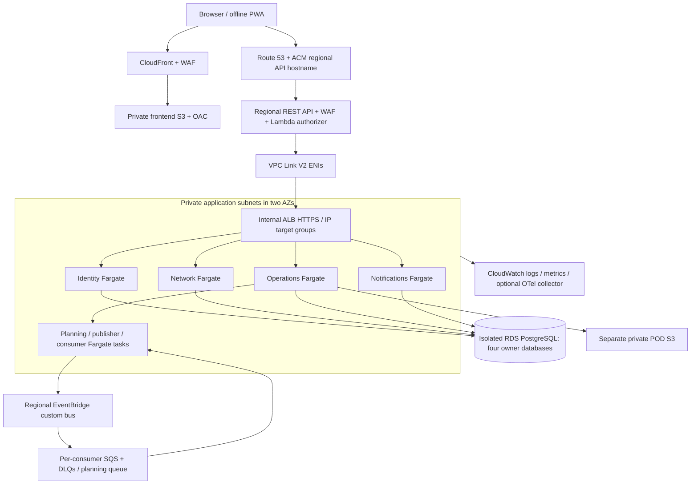

# AWS deployment reference reconciled with the implementation

Status: application/runtime readiness, not a deployed environment. No AWS resources,
CI/CD, Terraform, CloudFormation, CDK, Helm, or provisioning scripts were created.
The original [proposed architecture](waypoint_aws_architecture.md) is retained
unchanged. This document records what is implemented and what the deployment owner must
configure and validate.

## Decisions and regional verification

Use ECS Fargate for the four APIs and independent publisher/consumer/planning tasks. The
repository has no Kubernetes-specific dependency justifying EKS. Use separate ECR images
for identity-access, network-fleet, operations and notifications; planning reuses the operations
image. Start with one RDS PostgreSQL instance hosting four separately secured databases.
Orders/planning/loading/delivery are intentionally combined as described in the ADR.

The candidate region is ap-south-1 (Mumbai), subject to measured Sri Lanka latency, account
quotas and current pricing. The [AWS regional endpoint reference](https://docs.aws.amazon.com/general/latest/gr/rande.html)
lists Mumbai, as does the [ECS endpoint reference](https://docs.aws.amazon.com/general/latest/gr/ecs-service.html); the [EventBridge FAQ](https://aws.amazon.com/eventbridge/faqs/) lists Mumbai
availability. No account-specific feature quota, ALB/VPC Link V2 capacity, end-user latency,
or price was measured. Confirm the actual API Gateway/ECS/Fargate/RDS/SQS/S3/EventBridge
feature availability and quotas in the selected account before deploying. Compare Mumbai
and Singapore using the owner's actual network tests and AWS calculator; no numeric price
or performance assurance is inferred from geography.

Use Regional API Gateway **REST API**, WAF, VPC Link V2 and an internal ALB. AWS documentation
confirms [REST VPC Link V2 supports ALB](https://docs.aws.amazon.com/apigateway/latest/developerguide/private-integration.html),
including the same-account and stage-path rewrite requirements. The [REST/HTTP comparison](https://docs.aws.amazon.com/apigateway/latest/developerguide/http-api-vs-rest.html)
confirms direct WAF support for REST and its absence for HTTP APIs. No claim is made that
HTTP API JWT authorizers apply to REST APIs.

## Ingress and logical topology

EventBridge, SQS, S3 and CloudWatch are regional managed services, not containers in a subnet.
`backend/local/nginx.conf` is the exact local route map. Deployment routes:

| Path | Target |
|---|---|
| `/api/v1/auth/*`, `/api/v1/admin/users*`, `/api/v1/reference/store-managers` | identity-access |
| `/api/v1/reference/*`, exact `/api/v1/admin/outlets`, exact `/api/v1/admin/vehicles` | network-fleet |
| `/api/v1/notifications*` | notifications |
| `/api/v1/orders*`, `/plans*`, `/planning/jobs*`, `/loading*`, `/driver*`, `/deferrals*`, `/analytics*`, remaining `/admin*`, `/uploads/*`, `/api/v1/evidence/*` | operations |

All abbreviated patterns above retain `/api/v1`. Put exact/most-specific matches before
broader reference/admin rules. Remove API Gateway's stage prefix before forwarding; preserve
multipart bodies, Authorization, correlation/trace headers, query strings and error statuses.
Do not cache protected API responses in CloudFront or API Gateway. Only static versioned assets
are public-cache eligible. Preserve the PWA's private device evidence and offline operation IDs.

## VPC, routing, security groups and egress

Example VPC: 10.20.0.0/16; choose nonoverlapping account CIDRs.

| Subnet class | AZ-A | AZ-B | Route / workload |
|---|---|---|---|
| public | 10.20.0.0/24 | 10.20.1.0/24 | Internet gateway; NAT only if required |
| private application | 10.20.10.0/24 | 10.20.11.0/24 | internal ALB, VPC Link ENIs, private Fargate tasks, endpoint ENIs |
| isolated data | 10.20.20.0/24 | 10.20.21.0/24 | RDS subnet group; no internet default route |

Allowed stateful SG edges: VPC Link SG → ALB SG TCP 443; ALB SG → API task SG TCP 8000;
network/operations/notification tasks → identity HTTPS endpoint TCP 443; each owner task SG →
RDS SG TCP 5432; workers → required endpoint SGs TCP 443. Keep task/worker groups separate
where useful. No public IP for API/worker tasks, ALB or RDS. Use verified TLS for RDS
(`sslmode=verify-full` plus the RDS CA) and HTTPS for identity calls; production settings
reject local AWS endpoints and insecure DB/identity configuration.

NACLs are supplemental stateless subnet controls. Explicitly permit both intended flows
and ephemeral return traffic; test ALB health checks, VPC Link, NAT and endpoint responses.
Do not rely on NACLs instead of SG identity/port isolation or copy blanket deny rules.

Prefer an S3 gateway endpoint and evaluate ECR API/DKR, Logs, Secrets Manager, SQS and
EventBridge interface endpoints with scoped policies. If internet egress is necessary,
production uses a NAT per AZ; a single demo NAT trades cost for an AZ failure risk.
Compare endpoint-hourly cost, NAT processing and cross-AZ transfer using current regional
pricing. Containers require no internet access for model inference.

## Identity, secrets and threat controls

The existing bcrypt/HS256 login contract is retained. Only identity owns password hashes
and signing keys. Other services call identity's `/auth/me` with bounded 1-second connect /
3-second request timeouts and deny requests if identity is unavailable. They ignore forwarded
role/user headers and enforce resource assignment locally. Password reset/suspension increments
auth_version, invalidating old tokens. JWTs require exp/iat/sub. No refresh-token flow existed
and none is invented.

For REST API use a Lambda authorizer that verifies through the private identity service or
performs the equivalent validated key/claims check. Do not trust an authorizer context alone:
services reverify the bearer token. Disable authorizer caching where immediate suspension is
required. Lambda authorizer infrastructure is the deployment owner's responsibility. A future
Cognito adapter must retain current frontend login/profile shapes; Cognito is not implemented
or silently substituted here.

Use Secrets Manager for each DB URL and the identity signing secret. Set a new JWT_SECRET
and retain the old one temporarily as JWT_PREVIOUS_SECRET for at most the maximum token
lifetime (default eight hours), then remove it and redeploy identity. Password/auth revision
checks continue during overlap. Task roles get only their own DB secret and exact S3/queue/bus
permissions. The runtime execution role pulls ECR images and writes logs; application task
roles do not get account provisioning permissions. No long-lived AWS keys are needed in AWS;
`test` credentials in Compose are exclusively emulator placeholders.

Threat controls: WAF request/rate limits on login and uploads; maximum proof 8 MiB plus
multipart overhead within ingress limits; MIME/magic restrictions and immutable keys;
resource checks against vehicle/depot/outlet; per-device replay identity and hash conflicts;
bounded sync batches; verified SQL parameters and bounded pools; private/no-store evidence;
private queue producers and DLQ replay auditing. Log structured timings, status and trace IDs,
not tokens, proof contents, passwords, URLs with signatures or raw event bodies.

## Data, object storage and service access matrix

| Principal | DB | AWS access |
|---|---|---|
| identity API/publisher | identity only | own secret; PutEvents restricted to identity source |
| identity consumer | identity only | receive/delete/visibility on identity queue |
| network API/publisher | network only | own secret; PutEvents restricted to network source |
| operations API/publisher | operations only | own secret, POD prefix get/put, operations events; planning SendMessage |
| operations consumer | operations only | operations receive/delete/visibility; local outbox writes |
| planning worker | operations only | planning receive/delete/visibility, operations outbox writes |
| notifications API/consumer | notifications only | notification queue receive/delete/visibility; own secret |
| frontend distribution | no DB | CloudFront OAC read of frontend bucket only |

RDS production: Multi-AZ, encryption, automated backups/PITR, deletion protection, TLS,
monitoring and recovery exercises. Demo: Single-AZ is explicit reduced resilience. Keep pools
at five steady + five overflow per process initially; account for every API/worker task and
migration connection before scaling. RDS Proxy is optional only after measuring connection
pressure/failover behavior. No cross-service SQL joins or shared ORM package.

POD uses a bucket separate from frontend/imports, public-access block, TLS-only policy,
SSE-S3 by default in the adapter; use SSE-KMS only with an explicitly configured/scoped key.
The proxy upload validates ownership and size before storing immutable metadata/key references.
Downloads are authenticated proxies or authorized 60-second GET URLs. A URL is bearer access
until expiration; [S3 presigned uploads can overwrite existing keys](https://docs.aws.amazon.com/AmazonS3/latest/userguide/PresignedUrlUploadObject.html),
so arbitrary client PUT keys are not exposed. Protect metadata during retries, retain originals,
and define evidence retention/lifecycle from business policy. Imports/exports remain private
and require authorized datasets; no competition files are included in images or public S3.

## Messaging, scaling and operational verification

Use the custom bus and dedicated queues/DLQs described in [events.md](events.md). Queue
policies restrict EventBridge by source rule ARN; IAM restricts producer source/bus/queue
resources. Configure KMS permissions when using customer keys. Scheduler runs the 16:00
Asia/Colombo cutoff command with an active configured dispatcher service actor. Handler time
checks, closure keys and inbox dedup tolerate duplicate scheduler delivery. No schedule is
provisioned by this repository.

APIs expose `/health/live` and `/health/ready`. Uvicorn drains HTTP work on SIGTERM; consumers
stop polling and finish bounded work; visibility renewals protect long tasks. Use 120-second
ECS stop timeout for planning/consumer tasks. Scale APIs from latency/CPU/request pressure and
workers from queue age and backlog per task. Set explicit max tasks and one planning job per
worker process; a job has a 90-second isolated process limit. Never scale past DB capacity.

CloudWatch JSON logs carry correlation and W3C trace context. Define metric filters/dashboards
for request latency/errors, pool timeouts, unpublished age/attempts, inbox conflicts, queue age,
DLQ depth, plan duration/served/deferred counts and proof failures. Distributed context is
implemented; an OpenTelemetry exporter/collector and deployed dashboards are not configured.
Set alerts before production; do not treat unexecuted cloud checks as verified.

Local mapping: PostgreSQL → RDS owner databases; Nginx → API Gateway/ALB routing;
LocalStack → EventBridge/SQS/S3; local Docker APIs/workers → ECS tasks. Provider docs confirm
[LocalStack EventBridge target APIs](https://docs.localstack.cloud/aws/services/events/);
the pinned 3.8.1 runtime passed local fan-out, queue redrive/replay and private-object checks.
The full workflow also ran through Docker services and workers. Emulator checks do not prove
AWS IAM, network isolation, real service limits or disaster recovery.
`local/aws.sh` is guarded and runs only as a local emulator initializer, not an AWS provisioning script.

Recovery planning assumptions, not SLAs: aim for RPO ≤5 minutes with verified RDS PITR and
RTO ≤2 hours after a practiced restore; actual values require measurement. Restore DBs and
object metadata/versions together, keep inbox/outbox records during recovery, then replay
unacknowledged messages. An application rollback after new-owner writes requires reconciliation,
not restoration of a stale source. See the runbooks for exact local validation and cloud-only
acceptance checks.
