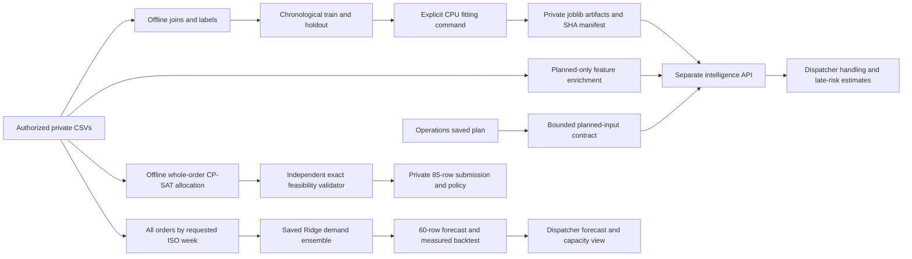

# Datathon models and preprocessing

The backend owns the copied implementation. [Runtime instructions](../backend/intelligence/README.md)
cover private assets, exact commands, scores and the supplied reference-data horizon. Neither
application imports nor Compose mounts reference the removable `Waypoint-Datathon` directory.

Task 1 joins deliveries to route legs with one-to-one route/sequence validation. Service time
excludes waiting before the outlet opens: `leave − max(arrival, opening)`. Late means actual
arrival exceeds closing. Nonnegative labels and identifiers are checked. Actual outcomes serve
only as targets. Planned inputs join outlet access/dock windows, vehicle capacities, calendar,
traffic, road conditions and supplied handling allowances. Features include prefix planned loads,
route size, planned timing/slack and order-size interactions. Missing learned interaction columns
for absent brand/dock groups are filled with zero; other missing features cause an explicit error.
Complete planned routes must be supplied together to reproduce prefix and route-size features.

The compact candidate uses Ridge regression for minutes and logistic regression for lateness.
Numeric imputation/scaling and categorical encoding fit on the training partition only. Training
ends before 2026-01-05; the later holdout is never used to fit the candidate. The exact fitting
pipeline is retained in `backend/intelligence/task1.py`; this is trained competition data modelling,
not a pretrained model or a proprietary API integration. Saved artifacts are checked against a
local SHA manifest before deserialization; only deployment-controlled artifacts are accepted.
SHA checks detect accidental mismatch, not a malicious operator replacing both artifact and manifest.

Task 2A combines training orders with the provided Task 1 test order records, counts deferred and
not-run demand and groups requested `order_date` using the supplied calendar's ISO year/week.
Lag/rolling features use observations through the origin; future outcomes cannot change features,
as verified by an adversarial test. Known future calendar variables are allowed. Fresh chilled
volume is a subset of Fresh total; Style and Tech chilled output is zero. Saved forecast inference
preserves template identifiers/order and all ten horizon weeks. Recomputed aggregate WAPE and
macro subgroup WAPE are different statistics and are labelled separately.

Task 2B uses exact integer scaling rather than floating-point capacity tolerances. The copied
validator checks every identifier/decision and independently recomputes access, depot, fleet,
volume, weight, trip grouping, trip count and per-vehicle time budgets. Bounded optimization
retains earlier priorities and records feasible objective bounds. The private one-page policy
and per-trip calculations are generated from the actual export, including unavoidable oversize
orders and the optimistic refrigerated-capacity lower bound. Financial costs are not fabricated.

Offline experiment logs, executed notebook outputs, model files and CSV exports remain private.
`Waypoint_FinalNotebook.ipynb` has executable preprocessing/evaluation and a final saved-model
inference cell; it keeps public source outputs empty. Do not publish competition data or derived
artifacts without organizer authorization. A competition submission package still needs the
team's actual name, video, permitted sharing channel and original authors' AI disclosures.
