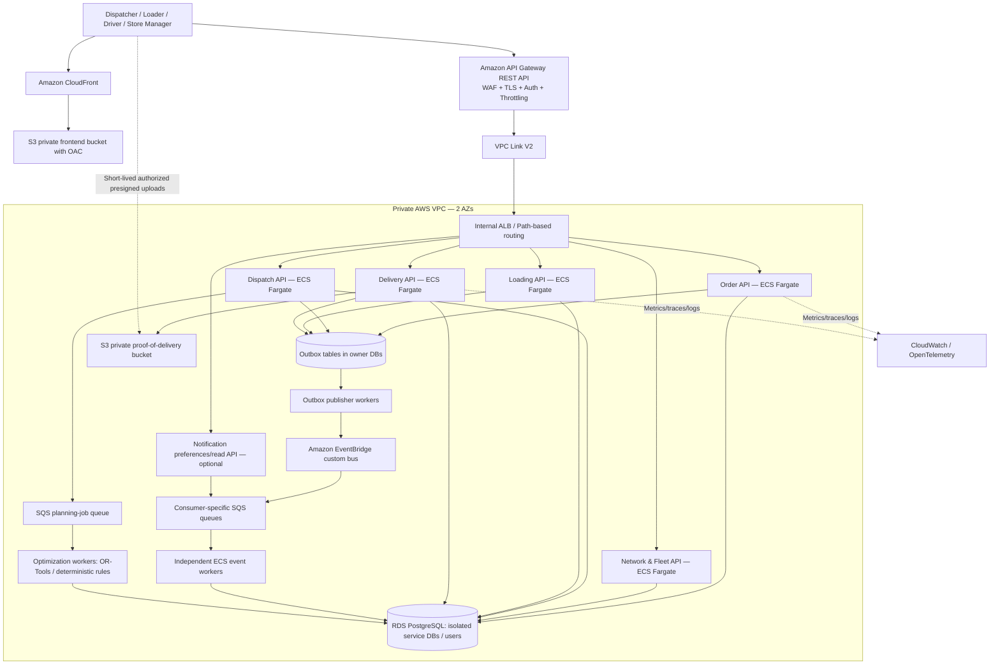

# Waypoint Delivery Management System — AWS Microservices Architecture

**Status:** Proposed target architecture, subject to a repository audit and functional validation.  
**Application:** React/TypeScript/Vite frontend and Python/FastAPI backend.  
**Scope:** Runtime architecture, networking, security, data, messaging, observability, and verification. CI/CD pipelines and infrastructure-as-code are deliberately excluded.  
**Reference business context:** Waypoint Tech-Triathlon 2026 challenge brief supplied by the project owner.

## 1. Architecture decision

Use **AWS ECS Fargate** for independently deployable FastAPI API and worker containers; **ECR** for images; **Amazon API Gateway REST API** as the external API boundary; **VPC Link V2** to an **internal Application Load Balancer**; **Amazon EventBridge + per-consumer SQS queues/DLQs** for events and commands; **Amazon RDS PostgreSQL** for transactional persistence; **Amazon S3** for private proof-of-delivery objects and controlled imports/exports; **CloudFront + S3** for the frontend; and **CloudWatch/OpenTelemetry** for telemetry. Use **AWS WAF** attached to the REST API stage (and optionally CloudFront). Do not put application services or databases on public subnets.

API Gateway **HTTP API** is a lower-cost alternative with JWT support, but does **not** support a directly associated AWS WAF web ACL. To keep direct WAF protection on the API itself, this design selects REST API. If the team instead prefers HTTP API, document a safe CloudFront/WAF front-door arrangement and prevent direct origin bypass; do not claim WAF can be attached directly to an HTTP API. A REST API VPC Link V2 can integrate directly with an ALB.

EKS is an alternative, not a requirement. Choose it only if a Kubernetes-specific operational need justifies its additional complexity; the FastAPI containers, network boundaries, PostgreSQL ownership, and event contracts remain portable.

## 2. Logical component diagram



**Diagram caveat:** The single PostgreSQL symbol is a **shared managed instance or cluster**, not a shared schema. Each bounded context owns a separate database or independently secured schema, its own migrations and database principal. No service may read or write another service's tables. EventBridge/SQS and S3 are regional managed services outside the application's subnet placement; the diagram groups them logically, not as physically hosted inside the VPC.

## 3. Proposed service boundaries

| Context | Owns | API and async responsibilities | Primary patterns |
|---|---|---|---|
| Identity & Access (managed Cognito/compatible IdP + authorization adapter) | Principals, user roles, permitted outlet/depot assignments, claims mapping | Authentication, JWT validation, dispatcher/loader/driver/store-manager authorization | RBAC + resource-based access, policy checks; avoid rewriting secure working auth unnecessarily |
| Network & Fleet | Depots, outlets, vehicle specifications, vehicle availability, weekly fuel accounting, calendar, reference travel times | Vehicle/outlet queries, availability commands, fleet-change events | Aggregate roots, repository and service abstractions |
| Order Management | Orders, confirmation, cutoff, order revisions, state transitions | Create/confirm/close orders; `order.confirmed`, `orders.closed`; immutable closure snapshot | Domain state machine, optimistic concurrency, transactional outbox |
| Dispatch & Planning | Planning jobs, allocation, plans, trips, stops, deferrals, constraints, plan versions | Allocate/replan/validate/commit; job commands/results; `plan.published`, `order.deferred` | Strategy/specification for rules, constrained solver adapter, job queue, optimistic concurrency |
| Warehouse & Loading | Loading manifests, load checks, shortages, damage flags, departure readiness | `load.started`, `load.shortfall_reported`, `load.completed` | Workflow state machine, idempotent commands |
| Delivery & Tracking | Assigned work snapshots, stop outcomes, location/status records if implemented, proof-of-delivery metadata, receipt confirmation, offline sync log | `delivery.started`, `delivery.completed`, `delivery.failed`, `receipt.confirmed`; sync endpoint | Inbox/deduplication, conflict-resolution policy, audit history |
| Notifications | Templates, notifications, delivery attempts, user preferences | Consume events, notify relevant role, retry failures | Event consumers, delivery retries, channel adapters |
| Forecasting & Intelligence (optional) | Model versions, prediction jobs and forecasts | Service time, late arrival risk, future demand predictions | Batch jobs, model adapter, inference versioning |

**Deployment granularity:** Start with fewer runtime deployments if needed. For example, identity can be managed, notifications may begin as one worker, and forecasting can remain a background job. Business boundaries do not require a separate ALB, RDS instance, or container for every feature at the outset.

## 4. Domain rules to implement and test

- Four roles: dispatcher, loader, driver, store manager; enforce route- and resource-level permissions.
- 120 outlets in Fresh (80), Style (25), and Tech (15); 60 vehicles based at either Peliyagoda or Kandy; only the outlet's assigned depot may serve it.
- Fresh chilled/frozen goods require refrigerated vehicles. A reefer can carry ambient goods; an ambient vehicle cannot carry chilled goods.
- Respect BOTH per-trip weight capacity and volume capacity; `van_only` outlets require a van; enforce mall and outlet delivery windows.
- Vehicle weekly fuel allowance and available vehicle state; at most two trips per vehicle per operating day; driver availability is not an independent allocation constraint in the provided baseline.
- Next-day orders close at 16:00 **Asia/Colombo**; after-cutoff orders move to the following applicable run according to calendar policy.
- Record all deferred orders with reasons and history; support fairness/avoid repeat deferral when feasible; never silently omit an order.
- Driver actions work offline and safely synchronize on reconnection; duplicate replay must not generate duplicate delivery or receipt records.
- **Separate Task 2B S1 validation rules** from general production planning rules: each trip serves ONE brand and ONE district; every whole order is either served or deferred and is keyed by **order_ref**, not outlet_id; no split orders; unavailable/in_workshop vehicles are excluded; trip_id ∈ {1, 2}; total Fresh time for a vehicle ≤270 minutes in the 03:30–08:00 window; combined Style/Tech time ≤480 minutes; calculate `trip_minutes = depot_to_district_freeflow_min + (number_of_orders - 1) * inter_stop_freeflow_min + SUM(service_allowance_min)`, and **do not add return travel** in S1 per the competition method. Task 2B does not supersede all other application rules.
- Treat forecast and prediction tasks as an **optional integration**: the challenge booklet explicitly allows the Datathon models to remain separate. If integrated, avoid external proprietary pretrained prediction models or proprietary API modelling that conflict with the competition's restrictions.

## 5. Service-internal FastAPI architecture

For each service, use the same structure as an **architectural template**, populated only where code is useful:

```text
services/<service-name>/
├── Dockerfile
├── pyproject.toml
├── alembic.ini
├── migrations/                         # Service-owned DB migrations
├── src/<service_package>/
│   ├── main.py                          # FastAPI application factory / lifespan
│   ├── api/
│   │   ├── v1/routers/                 # Thin HTTP endpoints
│   │   ├── dependencies.py
│   │   ├── requests/                    # Input validation DTOs
│   │   ├── responses/                   # Response DTOs
│   │   └── errors.py
│   ├── application/
│   │   ├── services/                     # Use-case orchestration
│   │   ├── use_cases/
│   │   ├── commands/
│   │   ├── queries/
│   │   └── interfaces/                  # Repository and external ports (Protocols/ABCs)
│   ├── domain/
│   │   ├── models/                      # Entities and aggregates, no ORM dependencies
│   │   ├── value_objects/
│   │   ├── events/
│   │   ├── rules/                       # Invariants and specifications
│   │   └── exceptions.py
│   ├── infrastructure/
│   │   ├── db/
│   │   │   ├── base.py
│   │   │   ├── session.py
│   │   │   ├── models/                  # SQLAlchemy ORM persistence models
│   │   │   └── repositories/            # Implement application interfaces
│   │   ├── messaging/
│   │   │   ├── publisher.py
│   │   │   ├── consumers.py
│   │   │   ├── outbox.py
│   │   │   └── inbox.py
│   │   ├── clients/                      # Typed inter-service / external adapters
│   │   ├── storage/                      # S3 or local file adapters
│   │   └── security/
│   ├── workers/                          # SQS event/command workers, job runner
│   ├── core/                             # Config, logging, tracing, exception mapping
│   └── bootstrap.py                      # DI composition root
└── tests/
    ├── unit/
    ├── integration/
    └── contract/
```

Shared repository code can live under `packages/` (tracing, contract schemas, test helpers, common error envelopes), but **do not share ORM models, repositories, service-specific business logic, or a universal database access package**. Use Pydantic for API schemas; plain Python dataclasses/typed objects for domain where appropriate; SQLAlchemy 2.x + Alembic as an example persistence stack, choosing against the actual repository dependencies. Use `Protocol` or `ABC` for meaningful interfaces, dependency inversion, repository and unit-of-work patterns where transactions justify them. Keep FastAPI routers thin; move I/O into adapters. Avoid over-engineering CRUD into dozens of trivial abstractions.

## 6. Eventing and resilience

- **Event bus:** EventBridge custom bus for business events. Route each event to **separate SQS queues** for each consuming service, including dead-letter queues. Use a dedicated SQS work queue for long-running planning jobs and horizontally scalable ECS workers. Use FIFO only where a documented per-aggregate ordering guarantee is required.
- **Producer consistency:** Persist the domain change and an outbox row in **one local database transaction**. An outbox publisher reads pending records, publishes to EventBridge, records delivery attempts, and retries safely. Prevent silent event loss on crashes; duplicate deliveries remain possible.
- **Consumer consistency:** Store `event_id` in a consumer inbox/dedup table within the local transaction, process idempotently, acknowledge the SQS message only after commit, and retry transient failures with backoff. Route poison messages to DLQ with alerting and replay instructions.
- **Contracts:** JSON envelopes with `event_id`, `event_type`, `version`, `occurred_at` (UTC), `source`, `correlation_id`, `aggregate_id`, and typed `data`. Define versioned contracts and compatibility tests.
- **Workflow:** Use events/handlers for propagation and local state machines for ownership. Where multiple services must coordinate, use an explicit saga/process-manager with compensations instead of distributed database transactions. Never claim exactly-once delivery from the broker.
- **Jobs:** Long planning/optimization tasks must return an accepted job ID rather than block API requests. Workers enforce timeout, concurrency limit, cancellation policy, and deterministic audit results.

## 7. AWS networking, ingress, and egress

**Suggested VPC:** `10.20.0.0/16`, across two Availability Zones (adjust to avoid overlap with any existing network). Example CIDRs:

| Type | AZ-A | AZ-B | Routing / contents |
|---|---|---|---|
| Public | `10.20.0.0/24` | `10.20.1.0/24` | Internet gateway route; NAT gateway(s) only if outbound internet is required; no public API tasks |
| Private application | `10.20.10.0/24` | `10.20.11.0/24` | Internal ALB, Fargate tasks, VPC Link ENIs, endpoint ENIs; optional NAT route for egress |
| Isolated data | `10.20.20.0/24` | `10.20.21.0/24` | RDS subnet group; no default route to the internet |

**Entry path:** `api.example.com` → Route 53 DNS → ACM TLS → Regional API Gateway REST API + WAF → VPC Link V2 → **internal** ALB → host/path rules and IP target groups → ECS Fargate tasks on private subnets. Prevent the ALB/tasks from having public exposure. Include REST API stage/path rewrite checks when proxying.

**Frontend path:** `app.example.com` → CloudFront → **private S3** static-hosting bucket with Origin Access Control. For offline-capable driver/loader PWA, correctly manage service-worker/versioned assets, cache scopes, and sync replay; do not cache confidential user responses publicly.

**Security groups (stateful, least privilege):** VPC Link SG can connect to internal ALB listener (e.g., TCP 443); ALB SG can connect to API task SG on the configured application port (e.g., 8000); only authorized service/task SGs can connect to database SG on 5432 or RDS Proxy SG; task egress is restricted to required DB, service endpoints and external integrations. Keep service-specific groups where feasible. Use TLS where possible on every hop; private AWS network access is not a substitute for encryption.

**NACLs:** Stateless, subnet-level supplementary controls; do not use NACLs as the primary mechanism for service isolation. Preserve necessary ephemeral return-traffic ranges in both directions. Start from documented, tested NACL rules and rely on security groups for workload permissions; avoid indiscriminate NACL denies that break ALB, VPC Link, or NAT traffic.

**Egress:** Prefer S3 gateway endpoint plus appropriately scoped interface endpoints (ECR API/DKR, CloudWatch Logs, Secrets Manager, SQS, EventBridge and other services actually used), with endpoint policies/security groups. Compare endpoint-hourly costs against NAT for the expected environment. In production, use one NAT per AZ *if NAT egress is required*; a single NAT is a lower-cost demo tradeoff and a single-AZ failure risk. Apply egress restrictions and minimize outbound connections.

## 8. Persistence and data ownership

- Start with **one private RDS PostgreSQL instance/cluster** hosting isolated databases or isolated schemas, **separate DB credentials/users per service**, and per-service Alembic migration history. A shared managed cluster is a cost/operations compromise; cross-service joins and direct table access remain forbidden. Split to separate RDS instances later if isolation, scaling, or compliance warrants it.
- Production: Multi-AZ DB deployment, automated backups/PITR, deletion protection, storage encryption with KMS, TLS in transit, monitoring, maintenance plans, and recovery drills. Nonproduction: single AZ permitted with clearly documented limitations.
- Configure bounded per-task SQLAlchemy connection pools and process counts; use RDS Proxy if scale/connections/failover behavior makes it worthwhile, not automatically. Avoid oversized worker pools that exhaust PostgreSQL connections.
- Use transactional outbox/inbox tables within each service-owned database, schema migrations, optimistic version columns and explicit consistency boundaries.
- Aggregate reporting across service-owned data through event-fed read models/analytics projections rather than SQL joins across service schemas.

## 9. S3 and other managed services

| Resource | Usage | Security/cost notes |
|---|---|---|
| Frontend S3 bucket | Versioned compiled static assets | Private bucket, public access block, CloudFront OAC, suitable cache controls |
| Proof-of-delivery S3 bucket | Signature/photo/document evidence, if supported | Private, SSE-KMS or SSE-S3 as justified, short-lived presigned upload/download with authorization, namespaced keys, allowed types/sizes, lifecycle, log access, prevent key overwrite |
| Imports/exports S3 bucket | Controlled ingestion and exports | Validate and scan uploads as appropriate, private bucket, least privilege, lifecycle and retention |
| ECR | Container images | Repository lifecycle and image scanning; no build pipeline requested |
| Secrets Manager | DB credentials, vendor secrets | IAM task role / execution role, rotation policy, do not log secrets |
| KMS | Key management | Separate policies for databases, S3 objects, and secrets as needed |
| CloudWatch / OpenTelemetry | Logs, metrics, traces | Structured JSON, correlation IDs, PII redaction, alarms |
| EventBridge Scheduler | 16:00 order closure and other recurring commands | Use Asia/Colombo schedule explicitly; handler must be idempotent and must evaluate operating-day/calendar constraints |

**Important file rule:** A presigned URL is bearer-like access until it expires; authorize the principal and exact object key before issuing it. Validate actual upload size/type and avoid overwriting another delivery's evidence. Never place private proof objects in a public frontend bucket.

## 10. Security and identity

- Prefer a managed OIDC/OAuth2 provider such as Cognito if integrating does not break existing frontend/auth contracts. Otherwise preserve the existing implementation and harden it. If using API Gateway JWT authorizers, confirm **API type and IdP signing algorithms**: HTTP API JWT authorizers have specific algorithm constraints; REST APIs can use Cognito authorizers or Lambda authorizers. In all cases, enforce fine-grained resource authorization **inside each service**; JWT verification by a gateway alone is not sufficient.
- Define least-privilege IAM roles per ECS task/service and execution role, restricted S3 prefixes/queues/secrets, and no long-lived AWS access keys in containers.
- Apply WAF managed protections, throttling, request-size constraints, strict CORS, security headers and rate limits. Protect login and file-upload paths appropriately.
- Audit every sensitive action: plan approval/replanning, deferral, shortage, driver sync, POD creation, receipt confirmation, and administrative changes. Record actor, correlation ID, before/after or action details without storing unnecessary personal data.
- Use ISO UTC timestamps internally plus explicit conversion to **Asia/Colombo** for business cutoff and display. Do not rely on server system timezone.

## 11. Performance, scale, and cost

- Keep FastAPI API processes mostly I/O-bound; do not execute OR-Tools route optimization, large reports, CPU-heavy data processing or model training on an async request/event loop. Run those in separate bounded ECS worker tasks and queues.
- Use request pagination, efficient SQL indexes/EXPLAIN, select-in eager loading where needed, no N+1 queries, connection pooling and bounded query durations. Cache only derived or expensive reads with explicit invalidation and TTL; add Redis only after demonstrating a need.
- Scale API tasks on CPU/memory/requests and workers on **SQS backlog per task** rather than queue depth alone. Account for peak 16:00 order cutoff and planning bursts. Keep baseline production instances in two AZs and define minimum healthy task counts.
- For a low-cost demo, start with fewer API deployments/tasks, 1-AZ nonproduction RDS and simplified egress (accept reduced HA), then expand to two-AZ production. Multiple always-running Fargate tasks, ALBs, NAT gateways and VPC endpoints have material fixed costs; estimate before provisioning.
- Frontend remains unchanged at the route/API-contract level during backend migration; introduce API compatibility adapters where needed.

## 12. Testing and operational readiness

| Layer | What must be verified |
|---|---|
| Unit | Domain invariants, cutoff/calendar, priority/deferral policy, outlet/vehicle constraint specs, event handlers and idempotency, time calculations, conflict merge policy |
| Property-based | For all generated allocations, no double assignment; weight/volume/depot/refrigeration/access/time/trip limits hold; every input order is served/deferred exactly once |
| Integration | Each service's real PostgreSQL migrations, repositories, outbox transaction, SQS consumers/publishers, S3 adapters, API auth, token/role permissions |
| Contract | Existing frontend endpoints and payload shapes; versioned inter-service HTTP and event contracts; error envelopes and pagination |
| Full workflow | Store manager confirms order → dispatcher commits plan/deferral → loader reports shortages → driver executes offline → sync/replay → store confirms receipt → notifications reflect outcome |
| Failure / resilience | Duplicate/reordered SQS messages, worker crash after commit, DLQ replay, partial S3 upload, offline conflicts, stale plan, deadlocks, database unavailable, gateway 5xx, reconciliation |
| Security | Missing JWT, forged identity headers, cross-outlet access, privilege escalation, signed-URL misuse, invalid MIME/size, rate limits, authorization of individual records |
| Performance | Peak 4 PM cutoff and concurrent read/write load; planning duration; queue lag; API p95; resource limits and memory pressure |
| Recovery | Restored RDS snapshot/PITR in test environment, reprocessed events, S3 object accessibility, rollback of a service release |

**Acceptance:** Real commands executed and their results recorded, not merely asserted. Include `docker compose up` for local application + PostgreSQL + practical queue/object-storage emulators/adapters, seed **permitted** synthetic representative data and four role accounts, and a repeatable judge walkthrough. Preserve existing frontend tests and add cross-boundary E2E tests.

## 13. Migration plan from the existing monolithic FastAPI backend

1. Audit endpoints, routers, models, business logic, SQL, background tasks, tests, roles and frontend API calls. Record existing working vs missing/incorrect features and a baseline test/build result.
2. Define contexts and ownership; identify coupling and which features can remain co-deployed initially. Prepare a route-by-route compatibility matrix.
3. Create shared infrastructure **interfaces/contracts**, not shared business/ORM models. Extract isolated bounded-context modules, then service runtimes incrementally.
4. Separate schemas/DB users and Alembic migration ownership. Migrate live data without dropping/recreating it. Take backups first. Use explicit data transfer scripts, validation, and rollback.
5. Introduce EventBridge/SQS contracts + outbox/inbox, beginning with order confirmation and plan publication; add a worker for expensive planning jobs.
6. Migrate warehouse, delivery and sync flows, then notifications and optional forecasting; preserve legacy frontend contracts through the API routing/compatibility layer.
7. Verify security, functional tests, contract tests and realistic end-to-end scenarios after **each** migration slice; only retire old code when consumers use the new path.
8. Publish `docs/aws-architecture.md`, `docs/microservices.md`, `docs/data-ownership.md`, `docs/events.md`, `docs/api-compatibility.md`, `docs/adr/`, and test/runbook notes. Record compromises and unverified AWS assumptions explicitly.

## 14. Required deliverables and out-of-scope

**Deliver:** Target architecture/diagram, service responsibility map, API migration and compatibility map, isolated database schema map, event catalog and failure policy, AWS network/subnet/SG/NACL plan, S3/RDS/service access matrix, local Docker Compose, migrations, real tests and execution logs, operational runbooks for data migration/recovery, and README walkthrough.

**Do not implement:** Terraform/CloudFormation/CDK, CI/CD workflows, GitHub Actions, AWS account provisioning, live resource creation, or costly cloud deployment without the user's explicit separate instruction. The repository should remain ready for the owner to write those scripts.

## 15. AWS documentation references (verified November 2026)

- [API Gateway REST API vs HTTP API feature comparison](https://docs.aws.amazon.com/apigateway/latest/developerguide/http-api-vs-rest.html)
- [REST API VPC Link V2 private integration](https://docs.aws.amazon.com/apigateway/latest/developerguide/private-integration.html)
- [HTTP API ECS private integration alternative](https://docs.aws.amazon.com/apigateway/latest/developerguide/http-api-private-integration.html)
- [AWS messaging selection: EventBridge vs SQS vs SNS](https://docs.aws.amazon.com/decision-guides/latest/decision-guides/sns-or-sqs-or-eventbridge.html)
- [ECS SQS-based autoscaling](https://docs.aws.amazon.com/AmazonECS/latest/developerguide/service-autoscaling-queue.html)
- [RDS Proxy](https://docs.aws.amazon.com/AmazonRDS/latest/UserGuide/rds-proxy.html)
- [VPC security best practices](https://docs.aws.amazon.com/vpc/latest/userguide/vpc-security-best-practices.html)
- [S3 presigned upload URLs](https://docs.aws.amazon.com/AmazonS3/latest/userguide/PresignedUrlUploadObject.html)

## 16. Data licensing and challenge constraints

The challenge booklet explicitly restricts sharing and publication of its provided datasets and derivatives without permission. Keep original competition files out of publicly shared Git repositories, container images, public S3 buckets, and external third-party services unless organizers authorize them. Reconcile this with the challenge's judge-seeding requirement through organizer-approved distribution or independently generated demonstration data. The Datathon rules also restrict pretrained models, proprietary modelling APIs and automated modelling tools; the optional forecasting service must respect those rules where applicable. The supplied brief is the source of these requirements; this AWS design is a proposed engineering solution, not the competition's prescribed architecture.
